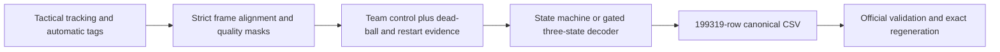

# Executive summary — twelve-day project decision

**Updated November 5, 2026. Official submission deadline: November 17, 2026.** Planning only; no implementation has begun. The repository's licensed match inputs are absent, so access is the first practical dependency.

## Recommendation

Enter **Phase 1: frame-level ball possession**, the only fully specified challenge in the folder. Build a **local tactical-data possession segmenter** that distinguishes missing ball observations from dead ball and reconstructs coherent H/A/D intervals. Start with a deterministic state machine; add capped automatic-tag fusion and a small three-state offline Viterbi decoder only after the MVP works.

The competition ranks **spellF1**, then macroF1 and further code-defined tie-breaks. There is **no Phase 1 jury or presentation score**. Innovation Challenge and Final Pitch are mentioned but not specified enough to rank or design for. [CHALLENGE — task](/Users/danieleitan/Desktop/more-than-a-hack-2027/CHALLENGE.md:3), [OVERVIEW — evaluation](/Users/danieleitan/Desktop/more-than-a-hack-2027/OVERVIEW.md:207).

## Ranked directions within the one challenge

These are strategic estimates, not official weights or measured performance. Full reasoning and sensitivity are in [PROJECT_STRATEGY.md](/Users/danieleitan/Desktop/more-than-a-hack-2027/planning/PROJECT_STRATEGY.md).

| Rank | Direction | Weighted score / 5 | Decision |
|---:|---|---:|---|
| 1 | State-machine foundation + capped evidence fusion / offline decoding (A+C) | 4.35 | Recommended, with narrow twelve-day scope |
| 2 | Conservative deterministic state machine (A) | 3.91 | Protected delivery fallback; strongest if capacity slips |
| 3 | Learned emissions + explicit-duration model (B) | 3.14 | Competitive research alternative, but needs unverified other-match labels and more time |
| 4 | Published smooth50 baseline | 2.99 | Reproduction/reference check; little differentiation |
| 5 | Tactical/broadcast fusion | 2.46 | Defer: no provided synchronization, cuts/replays complicate alignment |
| 6 | Rebuild video detection/tracking | 1.93 | Defer: high resource and validation burden |

## What makes the project competitive

The supplied baseline confuses lost ball observations with stoppage evidence. The ball is absent on about **41% of graded frames**, making this a central weakness. Our proposed system separates observation quality, team control and dead-ball reasoning, then places transitions from combined temporal evidence. This fits the scoring unit: a complete possession, not an isolated frame.

The innovation is a practical integration of those mechanisms, not a claim to have invented sequence decoding. No neural network, GPU, external API, cloud service or custom hardware is needed. The design is moderately difficult computationally and **moderate-to-high difficulty in data interpretation and segmentation**. Invisible whistles, long gaps and ambiguous control remain hard.

## How it works

ATD uses `video_frame = frame_id - 1`; the million-scale offsets in `games.py` are not the delivered ATD mapping. Decode the two published half windows separately. Treat tags as noisy phases, never exact possession labels. Preserve short supported possessions; avoid mandatory multi-second duration rules. Use local read-only diagnostic plots only after the core works. [DATA — alignment](/Users/danieleitan/Desktop/more-than-a-hack-2027/DATA.md:238).

## MVP and remaining schedule

**MVP:** a raw-data-to-CSV algorithm with correct indexing, missingness-aware control, basic stoppage/restart reasoning, deterministic output, official validator pass and documented reproduction. Copying a supplied baseline or producing only the public five minutes is not the proposed MVP.

Assume **three contributors × four focused hours/day × November 5–16 = 144 person-hours**. Plan **120 hours of work plus 24 hours reserve**, subject to actual team availability. This reduced A+C scope excludes learned-model research, broadcast alignment, replacement tracking and separate boundary refinement by default. Concept A alone is estimated at 70–90 person-hours.

| Date | Completion gate |
|---|---|
| November 6 | Licensed assets, exact schemas/timebase, baseline reproduction, team/form access verified |
| November 8 | Complete valid and reproducible state-machine MVP |
| November 10–11 | Core evidence integrated; optional decoder passes behavior checks; stop research additions |
| November 12 | Method/configuration frozen |
| November 14 | Clean reruns, identical CSV hashes, source/documentation ready |
| November 15 | Internal upload target; November 16 held for contingency |
| November 17 | Official deadline; exact cutoff hour/timezone still needs confirmation |

**Critical path:** lawful asset access → strict ingestion → full-match MVP → selected stable inference → clean regeneration → validated CSV + public repository + short technical document → submission receipt.

## Main risks and fallbacks

- **Access and alignment:** nine gated assets are absent from the checkout. Obtain them and validate every ID; do not silently pad, trim or substitute broadcast frames.
- **Missing ball, ambiguous stoppages, over-smoothing:** use separate evidence and finite temporal penalties. If advanced decoding fails, ship the frozen state machine; keep optional refinement off.
- **Invalid validation or unsupported accuracy claims:** the public five-minute GT is for correctness/semantics only, **never training, tuning or choosing models**. Use synthetic tests and permitted other-match labels if available. Without independent labels, report accuracy as unverified; hidden full-match performance cannot be established before judging.
- **Time and reproduction:** preserve the MVP, freeze early and remove optional modules. The final repository must regenerate the same file, not just similar metrics.

The competitive objective is to exceed the published private-match baseline **spellF1 0.2433**. This is not a guaranteed result or eligibility threshold. Public score comparisons cannot establish that gain. [EVALUATION — public window](/Users/danieleitan/Desktop/more-than-a-hack-2027/EVALUATION.md:125).

## First five actions for the implementation session

1. **Secure access and logistics:** confirm enrollment/terms, licensed tactical bundle, 3–5-person team, Google Form access and exact deadline timezone.
2. **Confirm real capacity and lock scope:** assign data, method and validation/release owners; commit to Concept A first and the November 8 MVP gate.
3. **Establish the reproducible reference:** create a tested pinned environment, inspect all frame IDs and team mappings, then regenerate the supplied baseline without public tuning.
4. **Freeze interfaces and validation rules:** define frame/evidence/output arrays and synthetic cases; isolate public GT from inference and selection. Drop any external-learning plan without verified data by November 6.
5. **Build the full-match MVP before enhancements:** implement missingness-aware state inference and canonical export, validate the exact file and prove matching rerun hashes; only then add the small decoder.

No action above was executed during this planning session. Only the six requested planning documents were created or edited.

## Document map

- [COMPETITION_ANALYSIS.md](/Users/danieleitan/Desktop/more-than-a-hack-2027/planning/COMPETITION_ANALYSIS.md): source inventory, authoritative rules, scoring and uncertainties.
- [PROJECT_STRATEGY.md](/Users/danieleitan/Desktop/more-than-a-hack-2027/planning/PROJECT_STRATEGY.md): weighted comparison, three concepts and decision rationale.
- [TECHNICAL_ARCHITECTURE.md](/Users/danieleitan/Desktop/more-than-a-hack-2027/planning/TECHNICAL_ARCHITECTURE.md): interfaces, algorithms, diagrams, tests and reproduction.
- [IMPLEMENTATION_ROADMAP.md](/Users/danieleitan/Desktop/more-than-a-hack-2027/planning/IMPLEMENTATION_ROADMAP.md): twelve-day tasks, effort, gates, critical path and risk register.
- [DEMO_AND_JUDGING_STRATEGY.md](/Users/danieleitan/Desktop/more-than-a-hack-2027/planning/DEMO_AND_JUDGING_STRATEGY.md): metric alignment, honest evidence, optional demonstration and hand-in.
