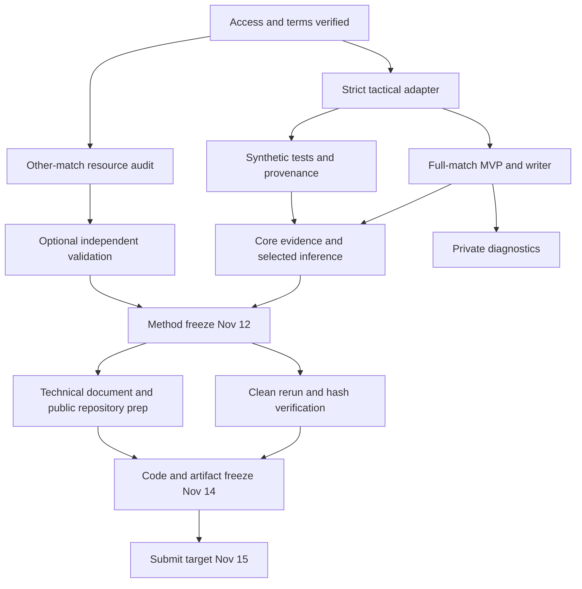

# Implementation roadmap and risk register

**Planning only — November 5, 2026.** No task below has been implemented in this session. This plan is conditional on lawful access to the match assets, which are absent from the inspected checkout. The selected project is tactical-only possession segmentation: conservative state-machine MVP, then capped tag fusion and a three-state offline decoder if justified. The architecture is specified in [TECHNICAL_ARCHITECTURE.md](/Users/danieleitan/Desktop/more-than-a-hack-2027/planning/TECHNICAL_ARCHITECTURE.md).

## 1. Official calendar and working assumptions

| Event | Official date | Source |
|---|---|---|
| Registration opens | October 1, 2026 | [README — Timeline](/Users/danieleitan/Desktop/more-than-a-hack-2027/README.md:164) |
| Data released | October 20, 2026 | Same |
| Submission deadline | **November 17, 2026** | [SUBMISSION — How to submit](/Users/danieleitan/Desktop/more-than-a-hack-2027/SUBMISSION.md:77) |
| Results announced | **Before November 26, 2026** | README — Timeline |

There is no documented 24/48-hour sprint, daily submission opportunity, live leaderboard, or jury pitch deadline. The official cutoff **hour and timezone are missing**. The 2027 title does not move the Phase 1 deadline into 2027. As of November 5, the deadline date is 12 calendar days away.

**Capacity assumption:** three contributors, each averaging four focused hours per day over November 5–16: **144 person-hours**. Allocate **120 person-hours** to planned work and **24 person-hours** to reserve. Person-hours are aggregate effort, not elapsed time; overlapping date ranges do not add extra staffing. Partial availability on November 5, enrollment delays, and actual skills must be accounted for at kickoff. Neither team membership nor this capacity is verified. If actual capacity is lower, cut advanced work first.

**Recommended internal dates, not official rules:** valid MVP by November 8; method freeze November 12; code and artifact freeze November 14; initial upload **November 15 by 12:00 America/Los_Angeles**; November 16 for contingency. Confirm the official cutoff before relying on any timezone conversion. Do not wait until November 17 for first upload.

Roles for a three-person team:

- **D — data/integration engineer:** strict loaders, features, serialization, reproducibility.
- **M — method engineer:** state machine, dead-ball logic, tag fusion, decoder.
- **V — validation/release lead:** synthetic/other-match validation, source provenance, technical document, release checks.

With four or five members, add a permitted-data/independent-validation owner and a diagnostics/reproduction owner. More people should improve validation and integration, not automatically add broadcast or deep learning. Keep 3–5 team membership as the conservative eligibility interpretation pending clarification of the parenthetical in [RULES — teams](/Users/danieleitan/Desktop/more-than-a-hack-2027/RULES.md:93).

## 2. Scope commitments

| Scope | What must work | What does not count as completion |
|---|---|---|
| **MVP** | Algorithm reads licensed tactical inputs; handles NaNs and exact frame alignment; uses team geometry, explicit stoppage evidence and conservative temporal state; emits full valid CSV; reproduces byte-for-byte; documents rules and limitations | A copied baseline CSV, a five-minute-only output, a visualization without inference, or manual corrections |
| **Competitive target** | MVP plus capped semantic tag fusion, three-state offline decoder if promoted, bounded boundary localization if promoted, complete synthetic/integration coverage, independent validation if available, polished reproduction and short technical document | More modules without evidence of useful behavior; a higher public score chosen by tuning |
| **Stretch** | Other-match-trained emissions/explicit durations, local visual checks, broader external validation, optional authorized playback | Any addition that delays full regeneration, depends on prohibited labels, or cannot be inspected by organizers |

An all-X file is format-valid but not a useful MVP. Passing the validator establishes eligibility of the file format, not prediction quality. Beating the published hidden-match baseline **spellF1 0.2433** is a competitive objective that cannot be confirmed locally; it is not a documented eligibility threshold.

## 3. Seven stages, tasks and acceptance criteria

Priority: **P0** = required to submit correctly; **P1** = competitive benefit with contained fallback; **P2** = optional. Estimates include implementation, local checks and brief documentation within each task. Larger independent verification is budgeted in Stage 6.

### Stage 1 — Environment setup and technical validation

**Window:** November 5–6. **Effort: 14 person-hours.** Owners D+V; M can design synthetic cases concurrently. The updated twelve-day scope excludes learned models, broadcast work and a separate refinement module by default. Advanced effort is limited to simple three-state decoding and minimal diagnostics. All environment changes below belong to a future authorized implementation session.

| ID | Task | Effort | Dependencies | Priority | Deliverable / acceptance |
|---|---|---:|---|---|---|
| S1.1 | Verify enrollment, accepted terms, 3–5 team, actual availability, form access, cutoff/timezone and nine gated assets | 3 h | Team/organizer access | P0 | Access/terms/provenance recorded; no assumption that a download link equals permission to publish data |
| S1.2 | Establish a tested Python 3.11 candidate environment with NumPy/pandas and exact dependency lock; inventory CPU/RAM/disk | 3 h | S1.1 for asset work | P0 | Import and official validator checks pass; package versions and machine recorded |
| S1.3 | Stream schema/timeline audit of tactical ATD, XML and tagging; validate every frame ID and half ranges | 5 h | Asset download, S1.2 | P0 | 199,319 exact ATD IDs, metadata team map, NaN counts, tag clock checks; no unresolved source mismatch |
| S1.4 | Reproduce published baseline from assets; verify official scorer behavior without optimizing against public labels | 3 h | S1.2–S1.3 | P0 | Exact reference behavior understood, including H/A-only window voting; configuration/provenance frozen for sanity check |

Risks: absent assets; unsupported default interpreter; confusing private-counter offsets with ATD IDs; parser quietly skipping bad records. Validation: exact complete index equality, known published half metadata, independent schema/roundtrip checks. Do not pad/trim a wrong video decode to meet row count. Parallel work: V records rules and submission checklist; M writes future synthetic scenario specifications. **Gate G1:** if tactical assets are not accessible by November 6, stop committing time to learned/video features, prioritize access, and state that feasibility remains unverified. Do not invent substitute competition data.

### Stage 2 — Foundational architecture and minimal prototype

**Window:** November 6–8. **Effort: 22 person-hours.** D owns contracts/export, M owns simple inference, V owns behavior fixtures.

| ID | Task | Effort | Dependencies | Priority | Deliverable / acceptance |
|---|---|---:|---|---|---|
| S2.1 | Define typed frame/evidence/prediction interfaces; implement strict streaming adapters and canonical geometry | 8 h | S1.3 | P0 | Exact frame joins; unit masks retained; slot/team mappings validated; no stable-player-ID assumptions |
| S2.2 | Implement proximity evidence, explicit dead-ball cues, and a conservative H/A/D state machine | 8 h | S2.1; simplified automatic tag adapter where available | P0 | Full match labels; missing ball alone never triggers D; true D breaks same-team possession; no mandatory multi-second spell floor |
| S2.3 | Build canonical writer, configuration/run manifest and official validation wrapper | 6 h | S2.1; can use synthetic outputs before S2.2 | P0 | Exact header, 199,319 rows, uppercase labels; repeated output hashes match; ungraded outside frames X |

Risks: evidence-free initialization, team alias errors, dead-ball ambiguity. Validation: synthetic H→A, H→D→H, long occlusion, stationary live ball, team swap, slot permutation, all-X failure case, no cross-half carry. **Gate G2, November 8:** valid reproducible MVP is mandatory. If missed, freeze at Concept A scope and remove DP/refinement/UI work until it exists. A baseline replay is a pipeline reference, not a claimed original solution.

### Stage 3 — Core functionality implementation

**Window:** November 8–10. **Effort: 28 person-hours.** M owns evidence/decoding; D and V work in parallel on data quality and tests.

| ID | Task | Effort | Dependencies | Priority | Deliverable / acceptance |
|---|---|---:|---|---|---|
| S3.1 | Add quality weighting, missing-ball context, robust team aggregates and track-jump rejection | 7 h | S2.1–S2.2 | P0 | Missingness preserved; duplicate/slot-order robustness; no long-gap fabricated trajectory |
| S3.2 | Implement code-aware Smart Tagging mapping, capped correlated evidence, explicit N/A handling | 7 h | S1.3, S2.1 | P1 | Defensive meanings treated deliberately; uncertain code families neutral; tag duplication bounded |
| S3.3 | Improve distinct stoppage-entry and restart-exit evidence with generic geometry/context rules | 8 h | S3.1–S3.2 | P0 | No blanket D across set-piece intervals; no exact XML-edge restart assumption; graded pre-kickoff interval retained |
| S3.4 | Implement the three-state offline dynamic program behind the same inference interface | 6 h | S2.3, S3 evidence interface | P1 | Deterministic path, finite scores, independent-half operation; exhaustive short-sequence objective checks pass |

Risks: overweighting correlated automatic tags, over-merging possessions, weak whistle evidence, score units inconsistent with penalties. Validation: no-ground-truth metamorphic tests; deliberately supported very short possessions; inject false/missing/overlapping tags; compare decoder objective on tiny exhaustive fixtures. Promotion uses the policy in Section 5, never public-score ranking. Parallel work: D extracts compact features while M implements DP on synthetic evidence; V audits external data and test definitions.

### Stage 4 — Advanced functionality and differentiation

**Window:** November 10–11. **Effort: 16 person-hours.** P1 work only after MVP is stable.

| ID | Task | Effort | Dependencies | Priority | Deliverable / acceptance |
|---|---|---:|---|---|---|
| S4.1 | Test evidence-based boundary placement; add bounded refinement only if needed | 4 h | S3.3–S3.4 | P1 | No boundary crossing or erasure of a supported short spell; weak regions retain original boundary |
| S4.2 | Run legally independent validation if acquired; otherwise execute predeclared synthetic stress/ablation suite | 4 h | Data gate G3, frozen candidate configs | P1 | Metrics have declared provenance; no fake hidden-match gain; no public sample used to choose routes |
| S4.3 | Add private evidence timeline and simple pitch/quality diagnostics | 4 h | S2.3, S3 evidence | P1 | Read-only inspection, no label-correction/export-to-training controls; missing observations displayed honestly |
| S4.4 | Profile full CPU run and simplify expensive or fragile paths | 4 h | S3 and candidate route | P1 | Measured runtime/RAM; target <10 min/<2 GB without video, or documented reduced route |

Risks: research drift, treating synthetic accuracy as real performance, hand inspection becoming manual annotation. Validate with a fixed fixture suite and independent other-match split if available. With no compatible independent labels, optional refinement stays off unless a clear generic behavior defect is demonstrated and fixed. **Gate G4, November 10:** abandon explicit-duration learning, broadcast fusion and custom video detection unless they are already independently validated and integrated; planned target needs none of them. **Gate G5, November 12:** freeze method/configuration using permitted evidence; no more hyperparameter changes for observed public performance.

### Stage 5 — System integration (hardware not applicable)

**Window:** November 10–12. **Effort: 8 person-hours.** D owns end-to-end run; M and V review.

| ID | Task | Effort | Dependencies | Priority | Deliverable / acceptance |
|---|---|---:|---|---|---|
| S5.1 | Integrate selected frozen route from raw assets to final CSV; prove no GT/network dependency | 5 h | S2.3, promoted S3/S4 modules | P0 | One documented command reproduces output; optional diagnostics can be disabled without changing it |
| S5.2 | Exercise module failure switches and data/feature contracts | 3 h | S5.1 | P0 | Missing tags/invalid homography produce documented behavior; missing required ATD fails visibly; no silently shortened output |

No embedded hardware, electrical calibration or sensor integration applies. Relevant integration is timeline, semantic and numerical consistency. Run the state-machine route and competitive route independently so a DP regression cannot destroy the fallback. Fallback selection follows generic tests or independent labels, not public scores.

### Stage 6 — Testing, debugging and reliability

**Window:** November 12–14. **Effort: 22 person-hours.** V leads; D fixes infrastructure; M fixes generic inference defects.

| ID | Task | Effort | Dependencies | Priority | Deliverable / acceptance |
|---|---|---:|---|---|---|
| S6.1 | Full semantic, missingness, adversarial and metamorphic suite | 7 h | S3–S5 | P0 | Critical fixtures pass; no manual competition-match labels; failure reasons logged |
| S6.2 | Two clean raw-data regenerations; independent teammate reproduction; compare hashes | 7 h | Frozen method, S5.1 | P0 | Same canonical CSV bytes; clean environment instructions complete; dependency versions pinned |
| S6.3 | Official validator on final candidate; restricted public correctness check; inspect artifact/source leakage | 4 h | S6.2 | P0 | Full submission contract passes; only documented implementation bugs may reopen work |
| S6.4 | Release and optional demo rehearsal, including failure path | 4 h | S6.1–S6.3 | P0 | Offline pipeline works; presentation cannot mutate output; backup hash/file verified |

Risks: accidental GT reads, public-driven model selection, platform serialization variation, excluded data cache becoming a hidden dependency. Tests are those listed in [TECHNICAL_ARCHITECTURE — integration](/Users/danieleitan/Desktop/more-than-a-hack-2027/planning/TECHNICAL_ARCHITECTURE.md). **Gate G6, November 14:** freeze source commit, lockfile, configuration and output hash. Only compliance/reproduction defects justify reopening; rerun affected checks after a fix.

### Stage 7 — Final demonstration and submission preparation

**Window:** November 13–15; November 16 contingency. **Effort: 10 person-hours.** V owns submission; another teammate verifies.

| ID | Task | Effort | Dependencies | Priority | Deliverable / acceptance |
|---|---|---:|---|---|---|
| S7.1 | Write short technical document: method, assets used/dropped, label provenance, rules, limitations, reproduction | 4 h | Method freeze; final measurements before completion | P0 | PDF or Markdown, team-named; all claims distinguish measurement from target |
| S7.2 | Prepare public source repository and release instructions; preserve required source-license notices | 3 h | Code freeze, S6.2 | P0 | Public URL usable by organizer; no licensed assets or reconstructive derivatives; exact regeneration command |
| S7.3 | Validate exact upload, submit form once per team, verify receipt/edit state and retain local record | 2 h | S7.1–S7.2, form/Google account | P0 | Correct team name, CSV, public URL, short document; upload bytes equal frozen hash |
| S7.4 | Optional concise technical walkthrough using authorized local or synthetic visuals | 1 h | Submission ready | P2 | 3-minute explanation and backup; no claim of an official Phase 1 pitch requirement |

The team-named `.md` format is explicitly allowed, although the naming example uses `.pdf`; clarify the form or use PDF at actual release if needed. This planning session creates Markdown only. No messages or uploads are sent now.

**Effort reconciliation:** 14 + 22 + 28 + 16 + 8 + 22 + 10 = **120 person-hours**. Reserve = **24 person-hours** from assumed 144. The 1-hour optional walkthrough is the first release-stage task to cut. Core compliance and clean regeneration are never traded for visual polish.

## 4. Critical path and concurrent work

The critical path is **licensed asset access → exact frame/schema contract → full-match state-machine MVP → stable evidence/selected decoder → clean regeneration → final validated file/public repository/technical document → form receipt**. Other-match labels, video overlays and broadcast synchronization are not on it.

Parallelization rules:

- After interface freeze, M develops decoder behavior from synthetic `EvidenceBatch` inputs while D completes real feature extraction.
- V establishes permitted validation and provenance before a trainable component is proposed, not after model work begins.
- The technical document outline starts during Stage 1; final claims wait for measured release artifacts.
- Diagnostics read immutable predictions and cannot block export. Optional plotting failures must not affect inference.
- No simultaneous uncoordinated edits to data schemas. One owner approves contract changes and all consumers update together.

## 5. Decision gates and compliant model selection

| Gate | Date / trigger | Pass condition | Failure action |
|---|---|---|---|
| G0 — rules/access | November 5 | Team/terms/form/cutoff verification initiated; assumptions recorded | Continue planning and synthetic setup only where appropriate; no assumed asset rights |
| G1 — tactical readiness | November 6 | Licensed required inputs, complete valid index contract | Resolve access first; cut optional work; do not claim feasibility from empty `data/` |
| G3 — independent labels | November 6 | Accessible **other-game** data, compatible label semantics/timebase, documented licensing/annotation and organizer accessibility | Freeze non-learning core; no HSMM training or accuracy-calibrated confidence claims |
| G2 — MVP | November 8 | End-to-end valid deterministic full-match system | Focus all engineering on Concept A and release essentials |
| G4 — research stop | November 10 | Optional feature already satisfies independent behavior/performance evidence and reproduction | Drop learned/video/broadcast additions and unnecessary refinement |
| G5 — method freeze | November 12 | Config selected without competition GT; synthetic robustness pass; lawful independent accuracy evidence if available | Ship simpler frozen route; record uncertainty |
| G6 — artifact freeze | November 14 | Clean reproduction, validator pass, hash, complete docs and no asset leakage | Fix only blocking defects; use executable fallback if required |
| G7 — submission | November 15 target | Form receipt and exact final artifact verified | Use November 16 reserve; contact organizer about access problems through team, not an invented alternate submission path |

A possible other-game resource is the public [Metrica Sports sample-data repository](https://github.com/metrica-sports/sample-data), whose README describes synchronized tracking/events and older sample games. This is **a candidate to audit**, not confirmed ready-made H/A/D possession ground truth. Check identity/date exclusion, terms, annotation provenance, label compatibility and access. Events alone do not establish frame-exact control and dead-ball labels. Do not quietly convert noisy event proxies into “ground truth.” No external data is a dependency of the target design. Source checked November 1, 2026; no dataset downloaded here.

**Promotion policy:** choose baseline configuration from generic design rationale; evaluate candidate features on predeclared synthetic invariants and permitted separate-game validation when available. If independent labels exist, split by match and primarily compare official spellF1; also monitor macroF1, transition timing, and failure slices. Without those labels, prefer the simplest route that passes behavior/robustness checks. Do not claim synthetic wins establish hidden-match gains. Do not search configurations for a preferred unlabeled possession share/count.

**Public-GT policy:** checks may establish indexing, output shape, label meaning and deterministic scorer integration. Never use public F1, its confidence interval, possession durations/counts, or visual agreement to select a model, threshold, checkpoint or decoder. After a legitimate schema/alignment bug, document the generic cause and add a synthetic regression fixture. Keep evaluation artifacts separate from inference inputs. The supplied instructional smoothing sweep does not authorize a new tuning sweep. [EVALUATION — public window](/Users/danieleitan/Desktop/more-than-a-hack-2027/EVALUATION.md:125), [RULES — forbidden data](/Users/danieleitan/Desktop/more-than-a-hack-2027/RULES.md:73).

## 6. Quantitative acceptance and reporting

| Measure | Acceptance / reporting policy | Meaning |
|---|---|---|
| CSV schema/index/labels | Exactly 199,319 data rows and canonical two-column contract; zero validator errors | Mandatory format correctness |
| Reproduction | Two clean reruns, identical SHA-256 and no GT/network access | Mandatory same-file behavior; hash equality is stronger than rounded metric equality |
| Critical behavior fixtures | 100% of predeclared P0 fixtures pass | Engineering correctness, not real-match accuracy |
| Runtime / memory | Target <10 minutes / <2 GB, CPU only excluding video; record measured hardware | Strategic convenience, no official cap |
| Public score | Optional frozen-method correctness report, explicitly marked 7,500-frame public window | Not a selection criterion or private score estimate |
| Other-match spellF1 | Report only if labels/semantics verified; use official matching | Independent evidence with domain-shift limitations |
| Hidden full-match spellF1 | Objective: exceed published 0.2433; value remains unknown until official evaluation | Actual ranking criterion |
| Complexity removed | Document discarded assets/modules and why | Reproducibility and honest limitation disclosure |

No fabricated leaderboard target such as “0.8 F1 guaranteed” is defensible. Approximately 0.04 spellF1 and 0.01 macroF1 are organizer noise heuristics for the full match, not official tie tolerances or guaranteed significance thresholds. Official bootstrap uses the 5th/95th percentiles, a 90% interval; it does not make public model selection permissible.

## 7. Risk register

Likelihood/impact are planning judgments (L/M/H), not measured probabilities. Owners use the early signals to act before the deadline.

| ID / category | Risk | Likelihood | Impact | Early warning | Mitigation | Fallback / owner |
|---|---|---|---|---|---|---|
| R1 — access | Licensed inputs or terms unavailable | H currently: assets absent | H | No usable download/accepted terms by Nov 6 | Verify enrollment, file inventory and team access immediately | Keep pipeline/reference checks separate; defer accuracy claims; remove optional work; D/V |
| R2 — compliance | Public GT becomes tuning data, or manual competition-match labels enter design | M | H | Threshold adjusted after public score; hand-entered transitions; undocumented frame overrides | Separate inference/evaluation, parameter provenance, no annotation UI, peer audit | Remove contaminated parameters/data; return to documented generic configuration or permitted independent training; V |
| R3 — inference | Missing ball and whistle ambiguity cause false D or missed turnovers | H | H | Many labels flip solely with visibility; head gaps misinitialized; context contradicts geometry | Distinct live/dead evidence, capped phase support, uncertainty, burst-dropout/transition tests | Conservative state machine, disable risky gap filling; disclose residual error; M |
| R4 — segmentation | Smoothing/penalties merge short spells or create flicker | H | H | Entire halves become one label; alternating tiny runs; boundary lag in synthetic tests | Finite adaptive transition costs, no hard multi-second minimum, short-spell fixtures | Remove refinement/DP; frozen Concept A; M |
| R5 — integration | Wrong frame source, off-by-one, endpoint or unit convention | M | H | ~164k rows, tag clock mismatch, shifted overlays, invalid distance scale | Explicit tactical index, every-row validation, half-open intervals, published data contract | Block output; correct parser generically; never pad/trim/relabel to fit; D |
| R6 — data/model | Other-match labels unavailable or semantically incompatible | H | M target / H learned route | Only event timestamps, unclear control convention/license, same-game contamination | G3 audit, match-level split, documented derivation | No learned model, no calibration claims; synthetic checks only; V/M |
| R7 — tags | Automatic phases contradictory, missing N/A team or inverted defensive meaning | H | M/H | Duplicate tags dominate score; every throw-in gets a fabricated team | Explicit code semantics, total/family caps, uncertainty masking | Neutralize disputed families or all tags; retain geometry route; M |
| R8 — third-party | API quota/network/model availability or organizer cannot access model | L for target; H if introduced | H | Remote calls in inference or undistributable weights | Core has no API; vet licensing/access before optional use | Local deterministic pipeline; omit remote module; D/V |
| R9 — hardware | Insufficient RAM/storage, no GPU | M | M | Object-heavy loader swaps; disk cannot hold bundle; video batch exhausts memory | Stream compact arrays, measure bundle size, CPU-first profiling | Omit video/kloppy object graph; process halves; no GPU dependency; D |
| R10 — time | Integration starts late or scope expands into tracking reconstruction | M | H | No valid full CSV by Nov 8; unmerged branch by Nov 10 | Daily full-run status, fixed interfaces, gates, 32 h reserve | Cut P2, refinement, DP in that order as needed; keep release tasks; all |
| R11 — deployment | Unpinned packages, nondeterminism, hidden cached state | M | H | Hash changes across reruns; clean machine cannot run; only notebook works | Lock environment, canonical CSV, raw-to-output CLI, independent rerun | Known-good frozen state-machine release; D |
| R12 — live demo | Renderer/video/network fails or selected clip looks incorrect | M | L for Phase 1 | Only demo route runs; presentation changes outputs | Demo independent of inference; rehearse offline | Validated CSV/hash plus synthetic/static diagram; V |
| R13 — licensing | Restricted video/tracking exported publicly or to hosted LLM | M | H | Clips, coordinate caches or model examples in public Git; external content uploads | Keep assets/caches private, review complete repository history/artifacts and actual enrollment terms | Synthetic visuals and source-only public release; remove unpublished artifacts before release; V |
| R14 — submission | Unknown cutoff, wrong form/team, upload failure, missing deliverable | M | H | No emailed form/Google account by Nov 6; repository still private Nov 14 | Verify early, two-person checklist, target Nov 15 upload | Nov 16 reserve and organizer clarification; no fabricated submission channel; V |
| R15 — conceptual | Stable-looking output mistaken for higher accuracy | H | H | Celebrating fewer segments or pseudo-label agreement without independent labels | Separate engineering robustness from accuracy; document uncertainty | Submit honest conservative system, no unsupported performance claims; M/V |

### Three most dangerous threats

1. **R2: disqualification through contaminated validation.** There is no lawful shortcut using the visible five minutes. Data separation, provenance and a frozen generic configuration prevent an apparently strong public score from becoming an invalid method.
2. **R3/R4: systematic dead-ball and transition mistakes.** Missing-ball handling is central, and spellF1 punishes both fragmentation and over-merging. The plan addresses this before UI work, retains a simpler executable route, and permits genuinely short possessions.
3. **R1/R5/R10: losing the schedule before a valid end-to-end system exists.** The inputs are currently absent and alignment is easy to misread. Early access/schema gates, a November 8 full-match MVP and 24 person-hours of reserve protect the critical path.

R14 remains a release blocker even if the algorithm is excellent; early form/cutoff checks are mandatory administrative work, not deferred polish.

## 8. Reduced-capacity and failure plans

- **Only 70–90 person-hours available:** ship Concept A with strict loaders, modest generic tag/restart cues, full writer/validator, synthetic tests and reproducibility; omit DP/refinement/visual tooling. Retain the same compliance and documentation obligations.
- **One week lost to access:** reevaluate remaining capacity immediately; keep the state-machine target and reserve at least the final two days for reproduction/submission. Do not compress all validation into the last hour.
- **No independent labels:** proceed without learning; keep performance claims unknown. This is an explicit limitation, not a reason to use the public sample as validation.
- **Advanced route fails late:** switch to previously frozen state-machine command and regenerate from raw inputs. Revalidate/hash its final file; do not splice selected frame intervals from different predictions by hand.
- **No lawful match access at all:** the provided reference baselines support scorer study, but they do not establish an original competitive entry or a reproducible improved method. Report the blocker honestly; do not fabricate missing features or data.

The next execution session should begin with the five actions in [EXECUTIVE_SUMMARY.md](/Users/danieleitan/Desktop/more-than-a-hack-2027/planning/EXECUTIVE_SUMMARY.md), not application initialization or interface polish.
