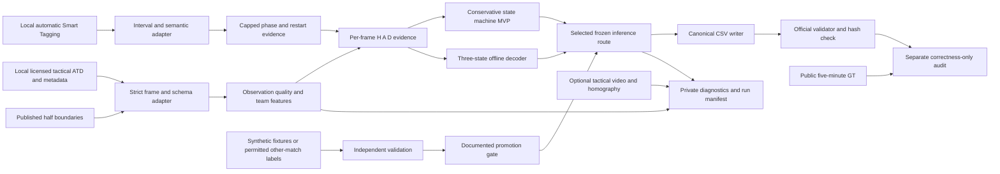

# Technical architecture — possession segmentation from incomplete evidence

Planning baseline: **November 5, 2026**, repository commit `f8f2629`. This is a design, not an implemented or benchmarked system. All numbers labeled “target” or “initial hypothesis” are engineering recommendations, not competition requirements or measured results.

## 1. Design decision and scope

Build a local, offline Python pipeline using tactical Automatic Tracking Data (ATD), automatic Smart Tagging, and optional homography-assisted diagnostics. Its output is a deterministic `frame,label` CSV with 199,319 rows. The competitive design combines **Concept A's conservative state machine** with **Concept C's evidence-driven boundary reasoning**, using a small three-state dynamic program when it passes the promotion gates. Keep the state machine as the executable fallback.

The principal innovation relative to the supplied baseline is to distinguish **unobserved ball**, **live possession**, and **stoppage evidence**, then infer complete possessions rather than make unrelated nearest-player decisions. Missing observations remain missing; they are not automatically `D`. Smart Tagging contributes limited evidence, not authoritative labels. This directly targets the possession-interval ranking metric.

The baseline's actual implementation counts H/A votes and emits D only if neither team has a vote in its window. Thus `smooth50` means **±50 frames, 101 frames total, 4.04 seconds**, not a two-second full window or an H/A/D majority. Reproduce that reference accurately before attributing improvements. Sources: [baseline.py — `nearest_player_labels`, `smooth`](/Users/danieleitan/Desktop/more-than-a-hack-2027/starter/baseline.py:109), [EVALUATION — baseline comparison](/Users/danieleitan/Desktop/more-than-a-hack-2027/EVALUATION.md:98).

### Scope tiers

| Tier | Components | Dependency policy |
|---|---|---|
| MVP, by November 8 | Strict tactical ingestion; team proximity and observation quality; explicit dead-ball evidence; conservative state machine; canonical CSV; validation and repeatability | Python, NumPy, pandas, standard-library XML/CSV only; Smart Tagging when delivered |
| Competitive target | Capped code-aware tag evidence; offline three-state decoding; evidence-based transition localization; perturbation tests; local diagnostic plots; reproducible hand-in | Same inference stack; Matplotlib optional for diagnostics |
| Stretch | Explicit-duration model or other-match-trained emissions; local visual verification; broadcast alignment | Separate approval of feasibility at the roadmap gates; never needed to regenerate the core result |

No web application, backend service, database, LLM, cloud API, player re-identification, GPU training, or physical hardware is required. Their absence reduces failure points; none earns an independent Phase 1 score. See [OVERVIEW — evaluation criteria](/Users/danieleitan/Desktop/more-than-a-hack-2027/OVERVIEW.md:207).

## 2. High-level architecture and execution flow

There is deliberately no path from public ground truth to feature extraction, parameter fitting, decoder selection, or configuration. Public checks are isolated from inference. Prediction uses the **published complete half windows**, never the public CSV's much shorter valid mask.

Execution sequence:

1. Read a versioned configuration and input manifest; check required files and hashes locally.
2. Validate every tactical record and timeline join before producing features.
3. Convert geometry to consistent units, retain observation masks, and aggregate by team.
4. Rasterize automatic phase evidence and restart neighborhoods onto tactical frame IDs.
5. Compute bounded, quality-weighted scores for H, A and D.
6. Decode each published half independently, using the selected frozen inference route.
7. Set only the published ungraded exterior frames to X. Within halves, output the inferred H/A/D state; reserve X for explicitly defined complete evidence failure.
8. Serialize the entire frame sequence canonically, run the official validator, and verify exact regeneration.
9. Generate optional private diagnostics from the same frozen outputs; diagnostics never edit predictions.

Offline look-ahead is a **design assumption supported by** the full-match CSV task, absence of a streaming restriction, and supplied centered baseline. It is not a claim of real-time inference. A later streaming variant would need separate latency and accuracy evaluation.

## 3. Input contracts and coordinate discipline

| Input | Canonical representation | Required validation and failure behavior |
|---|---|---|
| Tactical raw ATD + metadata XML | `frame_id` 1…199319; normalized player/ball x,y; speed; slot-team mapping | Require every integer ID exactly once and in exact order. Check slot cardinality against metadata. Reject malformed rows, unexplained ID gaps, unknown team IDs and shape mismatches. Do not silently skip and shift rows. Missing numerical observations stay NaN. |
| Canonical frame index | Zero-based tactical video frame 0…199318 | `video_frame = atd_frame_id - 1`; assert equality of every ID, not only count and endpoints. |
| Team map | `H`, `A`, or invalid | Confirm XML teams correspond to Barcelona and Athletic. Match `Atletic Club` tagging spelling via explicit documented alias. Never infer a shirt number from a track slot. |
| Smart Tagging | Records `{start, stop, code, team?, tags}` with half-open `[start, stop)` frames | `round(seconds*25)`, lowercase/strip for matching, preserve original text in private audit. Check finite ordered timestamps; clip only intervals legitimately crossing recording edges and record that action. Unknown/malformed types provide no evidence. |
| Homography, optional | `H[N,3,3]`, `valid[N]`, `error[N]` | Validate exact frame sequence separately from loading. Check finite matrix, validity, invertibility/conditioning and projection denominator. Invalid transforms disable overlay/visual evidence; never delete CSV rows. |
| Official half metadata | `[11185,90652)`, `[110808,190198)` | Only these published ranges define inference blocks; reset all temporal state at their boundaries. |

Delivered ATD **does not use** the million-scale `id_frame` offsets in `games.py`. Those belong to the counter underlying corrected ground truth. `games.py`'s opening comment is misleading for participant ATD. Use [DATA — frame alignment](/Users/danieleitan/Desktop/more-than-a-hack-2027/DATA.md:238) and [load_atd — participant alignment](/Users/danieleitan/Desktop/more-than-a-hack-2027/starter/load_atd.py:22).

The raw alignment helper checks count and endpoint span; that does not prove absence of interior duplicate/missing IDs. The new adapter must check the full sequence. The homography loader also does not automatically call its alignment checker. These are validation requirements for the future implementation, not changes made in this planning session.

**Coordinates:** keep normalized x,y for projections; multiply by `(105.3,68.0)` for metric distances to match the published baseline convention. ATD metadata and plotting helpers use 105×68 m; record the deliberate choice and do not mix both scales. Do not clamp out-of-pitch coordinates before calculating out-of-play evidence. An implausible outlier is not proof the ball went out. Homography is a ground-plane mapping, not a ball-height measurement. See [DATA — ATD and homography](/Users/danieleitan/Desktop/more-than-a-hack-2027/DATA.md:88).

**Anchor disagreement:** `games.py`'s clock anchors yield 11186 and 113741; the Smart Tagging helper/FAQ use 11185 and 113742. Use exact delivered IDs and published half boundaries. Treat kickoff anchors as diagnostics pending clarification, never as private label overrides. The published pre-second-kickoff D disclosure is a semantics check; the default design infers its stoppage using generic evidence rather than hardcoding those labels.

## 4. Storage and internal interfaces

Use typed NumPy arrays for batch inference, standard-library JSON for configuration/manifests, and CSV for final output. No database is needed for one match. Keep raw assets immutable and local. Private feature caches must remain outside public version control because they may reconstruct licensed data.

| Logical interface | Fields / shape | Consumer |
|---|---|---|
| `FrameBatch` | `frame:int32[N]`, `half:int8[N]`, `ball_xy:float32[N,2]`, `ball_valid:bool[N]`, `player_xy:float32[N,S,2]`, `player_valid:bool[N,S]`, `slot_team:int8[S]`; optional speed and source quality | Feature extraction |
| `TagInterval` | `start:int`, `stop:int`, `code:str`, `team:optional enum`, `type:optional str`, original automatic source ID | Tag rasterizer |
| `FeatureBatch` | nearest distances for each team, relative margin, short-window persistence, ball displacement/speed where valid, gap age, team visibility/counts, stationary/outside evidence, phase evidence | Evidence model |
| `EvidenceBatch` | `scores:float32[N,3]` in H,A,D order; `switch_support:float32[N,3,3]`; reliability masks and reason flags | Either decoder |
| `PredictionBatch` | `state:int8[N]`, private confidence/margin, reason flags, half ID; contiguous canonical frames | Writer and diagnostics |
| `Segment` | `start:int`, `stop:int`, `label:enum`, boundary evidence and confidence descriptor | Private timeline/analysis |
| `RunManifest` | code commit, configuration hash, input hashes, dependency versions, route, seed if any, runtime, peak memory, output SHA-256, external-data provenance | Reproduction |

Freeze these contracts on November 6 so ingestion, inference and validation can proceed in parallel. Consumers reject unknown shapes and mismatched frame arrays. All interfaces are in-process function calls or local files; there are no network protocols or authentication requirements for inference.

For scale: `199319 × 46 × 2 × 4` bytes is about **73.35 MB** for float32 player x,y alone. Speed, masks, ball arrays, scores, caches and Python overhead add to this. Stream raw parsing and avoid a large per-player Python object graph; `load_atd.py` warns that full kloppy loading can take minutes and gigabytes. Initial target: **<2 GB peak RAM and <10 minutes total CPU-only inference**, excluding optional video decoding. These are unbenchmarked acceptance targets on a declared machine, not organizer limits. Profile before promising them. Process halves independently and cache only if needed.

## 5. Core algorithms

### 5.1 Observation quality and team control evidence

For each frame with a usable ball, calculate team nearest-player distances in metres:

`d_k(t) = min over valid players of team k ||p_i(t) − b(t)||`, for `k ∈ {H,A}`.

Use finite masks before reductions; a team with no visible player has **unknown distance**, not evidence that the opponent controls the ball. Both absolute distance and the distance difference matter: being the nearer team when everyone is far away does not establish control.

Map distance to bounded support, for example `u_k = exp(−d_k²/(2r²))`, gated by reliable ball/player observation. Combine proximity, team-distance margin, and short-window consistency. Optional relative velocity is useful only within a continuous plausible tracklet; reject jumps and identity switches. Team-level aggregation must be invariant to slot ordering and robust to duplicates. Avoid summing unbounded support over duplicate players.

A control change requires accumulated **opposing control evidence**. One touch or nearest-player flip does not force a turnover. A fast, unambiguously controlled short spell must still be possible: neither a hard multi-second minimum duration nor a mandatory pass count is justified by the rules. [CHALLENGE — control definition](/Users/danieleitan/Desktop/more-than-a-hack-2027/CHALLENGE.md:49).

### 5.2 Ball gaps and uncertainty

- Retain raw observation masks and time since/until valid ball observations.
- For a very short gap bounded by plausible observations, optional interpolation supplies a **low-weight feature**, not an asserted recovered trajectory. Mark interpolated samples separately.
- Never interpolate through halftime, across implausible jumps, or across a detected stoppage/turnover neighborhood. Long aerial/occlusion gaps remain unobserved.
- With no ball geometry, reduce proximity evidence to neutral. Continue temporal state using surrounding control and automatic phase evidence.
- Do not make gap length alone a D detector. Do not copy the last ball location indefinitely.
- Forward and backward evidence can disagree around a gap. Preserve that disagreement in diagnostics and allow a transition; do not make “same team before and after” a universal merge rule.

The full-match 59.3% graded ball visibility is an organizer-documented input limitation, not an accuracy measurement. Missingness is not random. Artificial dropout tests must include bursts concentrated around transitions as well as uniform dropout. [DATA — missing ball](/Users/danieleitan/Desktop/more-than-a-hack-2027/DATA.md:108).

### 5.3 Dead ball and restart evidence

Build separate bounded scores for live play and stoppage. Candidate cues include sustained reliable outside-pitch observations, low ball motion combined with restart context, and coordinated player slowing/repositioning. None alone is a referee oracle: a stationary ball may be live, a tracker may overshoot a boundary, and a moving ball may already be dead.

Set-piece intervals identify **restart neighborhoods**, not exact restart frames and not whole dead-ball stretches. Inside/around each neighborhood, look for a stationary-to-motion change and coherent control by a team. A nearby phase tag should strengthen already plausible evidence, not create a guaranteed D→H/A boundary at the XML interval edge. Never assume an arbitrary pre-tag duration is dead.

Entering D and leaving D need distinct evidence rules. Any H→D→H sequence remains two possessions. Goals/transition phases can supply weak context, but no automatic code is treated as truth. The largest residual risk is a whistle or stoppage with weak geometric evidence; describe this limitation candidly.

### 5.4 Automatic tagging semantics and correlation control

| Tag family | Proposed interpretation | Guardrail |
|---|---|---|
| Build Up, Progression, Creating Chances | Weak evidence of tagged team's live possession | Intervals can overlap, end early, or span turnovers |
| Attacking Transition | Weak support for tagged team's recovery | Transition timing remains inferred |
| Defensive thirds / Defensive Transition | Tagged team performs the defensive action; possible evidence for **opponent** possession | Validate documented semantics; disable uncertain groups rather than invert blindly |
| Set Pieces | Possible stoppage/restart neighborhood | `Team=N/A` supplies no team identity; every throw-in has N/A in documented data |
| Long Ball, Ball in Box/Final Third, Players in Box, Goals | Optional contextual support after code-specific review | No unconditional transfer of `Team` into output; off-ball actions differ from control |

Normalize tag strings and define an explicit per-code mapping. Deduplicate identical (code, team, start, stop) intervals and combine overlapping evidence within each family by max/union, not raw sums. Cap each family and the total tag contribution so ten correlated phases are not counted as ten independent confirmations. Conflicting H/A tags cancel or reduce reliability; do not resolve by XML file order. Use symmetric treatment of both teams. Tracking and Smart Tagging derive from the same underlying observations, so their apparent agreement is **not independent validation**. Sources: [OVERVIEW — tag meanings](/Users/danieleitan/Desktop/more-than-a-hack-2027/OVERVIEW.md:96), [DATA — tag caveats](/Users/danieleitan/Desktop/more-than-a-hack-2027/DATA.md:168).

### 5.5 Reliable decoder: conservative state machine

Maintain live controller H/A or stoppage D, evidence accumulators for competing states, and observation quality. Preserve current controller during loose/contested play. Switch when the alternative accumulates enough reliable support, using lower required support for strong restart/control observations and higher support for ambiguous nearest-player flicker.

State transitions are H↔A, H/A→D, and D→H/A; all are allowed. No minimum spell length is mandatory. Record the evidence onset separately from confirmation time, allowing bounded offline localization back to that onset. Begin each half with neutral evidence; if the entire block has no evidence, return X rather than fabricate a confident history. For a head gap with subsequent evidence, initialization must be documented and tested, not borrowed from public labels.

### 5.6 Competitive decoder: three-state dynamic programming

Use the same evidence interface as the state machine. Let `E_t(s)` be a bounded support score (not an asserted calibrated probability). Let `C_t(r,s)` be a nonnegative cost for a state change; self-transition cost is zero. Dynamic programming chooses:

`V_t(s) = E_t(s) + max_r [V_(t−1)(r) − C_t(r,s)]`.

Store backpointers and recover the best path separately for each half. Initialize the three states neutrally and use a fixed documented state tie-order. An all-evidence-missing block is caught before decoding and returns X. Scores and paths must not depend on hash iteration order, filesystem enumeration, or floating-point reduction parallelism.

Transition costs are **time varying**: lower them near supported control changes/restarts; raise them during ambiguous gaps. Keep them finite so a genuine short possession is not impossible. Cap the total contribution from tags. Avoid a learned duration prior in the core; three states require only `O(N × 3²)` decoder work and `O(N × 3)` backpointer storage. Feature computation is roughly `O(N × S)` for S player slots. This is substantially easier to reproduce and debug than a video network or long-duration semi-Markov search.

This objective is a **surrogate**, not direct optimization or a guarantee of spellF1. A one-state output is extremely stable but usually useless. Both fragmentation and over-merging must be tested. If the decoder fails promotion, ship the frozen state machine; do not choose the route from the public sample score.

### 5.7 Boundary localization and limited refinement

The target behavior is evidence-centered boundaries without long smoothing lag. Dynamic programming can already place a boundary at evidence onset. Add a separate local refinement only if independently justified: for adjacent fixed labels `r,s`, maximize cumulative local evidence before/after a candidate boundary inside a bounded window, preserve boundary order, and reject a move that erases an intervening supported short possession. Complexity is bounded by number of transitions × window length.

Default fallback is **no additional refinement**. Overlapping search windows, weak evidence and tag-only triggers keep the original decoder boundary. Refinement must never consult ground truth or a list of manually identified match transitions.

### 5.8 Parameter policy

Before implementation, record a small initial configuration and its generic rationale. A practical starting **hypothesis**, not a fitted optimum, is a 3 m proximity scale, maximum interpolated gap of 10 frames (0.4 s), optional refinement radius of 25 frames (1 s), and tag contributions capped below strong observed-control evidence. Keep interpolation/refinement disabled in the first MVP so each can be removed cleanly.

Transition penalties, stationary-motion scales and evidence thresholds must be explicit configuration values, selected through predeclared synthetic behavior tests or permitted other-match validation. Use relative evidence units consistently; do not claim calibrated confidence from an arbitrary score. No minimum possession duration or prescribed total possession count/share is allowed to emerge from the public sample. If no independent labels are available, freeze the simple configuration and state that its accuracy is unverified. A sensitivity sweep on unlabeled inputs may expose instability; it cannot prove which variant is more accurate or justify choosing a desirable match possession count.

### 5.9 Export and abstentions

Output exactly `frame,label`, integer frames, uppercase labels, UTF-8, LF, no extra columns, no index, no blank cells. Use deterministic row iteration and line termination. X outside the two published half windows is appropriate. On graded frames prefer the decoder's H/A/D estimate when evidence is usable; a confidence display is separate from submission labels.

Official temporal scoring forward-fills X, then backfills the head of each **contiguous GT-valid run**, not unconditionally the whole half. The public run is only `[11185,18685)`; final GT has the two full halves. An all-X run remains X. Therefore X is not a neutral hedge at a transition and is charged as a miss by macroF1. [possession_metrics — `valid_runs`, `fill_abstentions`](/Users/danieleitan/Desktop/more-than-a-hack-2027/evaluation/possession_metrics.py:259).

## 6. Technology, deployment and hardware

| Choice | Justification | Verification needed |
|---|---|---|
| Python 3.11 candidate environment | Repository explicitly reports evaluator compatibility; convenient deterministic batch stack | Install only in a later implementation session; verify available interpreter and pinned package combination |
| NumPy + pandas + standard library | Already required by scorer; sufficient for arrays, metrics, parsing and serialization | Pin exact tested versions in submitted repository; current upstream requirements are not fully pinned |
| Raw ATD parser based on starter contract | Avoids loading a large kloppy object graph and removes optional dependency | Validate all rows; preserve MIT notices when reusing substantial code |
| Matplotlib, optional | Existing pitch helpers; static plots or local animation without frontend/backend integration | Verify installation/backend; no need for ffmpeg when using static figures or JS animation |
| kloppy 3.18.0, optional only | Starter pin documents tested EPTS format support | Old pin may constrain environment; do not make core inference depend on notebook installation |
| No learned model in target | No confirmed compatible other-match labels; public labels cannot train it | Learned emissions/HSMM remain a gated alternative, not an unfulfilled core dependency |

The official [NumPy fundamentals](https://numpy.org/doc/stable/user/basics.html) document the array operations needed here. [Matplotlib's animation guide](https://matplotlib.org/stable/users/explain/animations/animations.html) supports local figure animation and JS HTML output; this is optional communication, not model quality. These external references verify technical capabilities only and do not amend competition rules. Checked November 1, 2026; no claim that latest package releases should replace a tested pinned environment.

**Hardware:** an ordinary CPU laptop/workstation is the assumed development environment. Its actual CPU, RAM and free storage must be inventoried at Stage 1; 16 GB RAM is a planning preference, not a verified resource or requirement. Disk must accommodate the actual licensed bundle, one working cache and temporary outputs; bundle size is unknown, so no promised storage estimate. No microcontroller, sensor, actuator, electrical interface, calibration rig or custom power supply applies. Normal laptop power and a spare power adapter are sufficient for an optional demonstration. Optional GPU/video work is cut if access is not already verified.

**Deployment:** local command-line batch execution from an immutable commit, offline after dependency acquisition. A proposed future command is `python -m possession_pipeline --config config.json --data-dir <bundle> --output <team_name>.csv`; this module does not exist yet. Documentation must provide the eventual real command, tested on a clean environment. A container is optional only if already familiar and it reduces reproduction work; never package licensed assets in the image.

## 7. Integration, validation and reproducibility

### Meaningful tests planned for implementation

1. **Schema/alignment:** exact every-row ATD/homography indexes, wrong source rejection, half-open tag boundaries, team alias mapping, coordinate scaling, no output truncation/padding.
2. **Semantic fixtures:** live missing ball retains controller; actual D splits same-team possessions; one-touch opposition does not automatically switch; strong short control can switch; stationary live play is not automatically D; restart team can be unknown; no state crosses halftime.
3. **Adversarial observations:** NaNs, no players for one/both teams, duplicate slots, slot permutation, identity jumps, long gaps surrounding turnovers, contradictory/missing/duplicated tags, bogus homography and out-of-pitch spikes.
4. **Decoder:** short paths compared with exhaustive enumeration of the proposed objective; deterministic ties; finite scores; transition timing; state machine and DP each independently runnable.
5. **Scorer semantics:** synthetic H/D/H, X-in-gap, all-X and two-run cases evaluated with unmodified official metric functions. Never substitute a custom matching algorithm for the official greedy same-team IoU matcher.
6. **Metamorphic properties:** swapping H/A inputs swaps outputs on nondegenerate evidence (document exact-tie behavior separately because a fixed tie-order can break symmetry); permuting slot order preserves output; duplicating a tag does not multiply its influence; removing observations reduces confidence rather than silently creating a D label; identical input/config gives byte-identical output.
7. **Integration:** full-length CSV passes official validator, then two clean reruns match SHA-256; no GT file reads during inference; no network calls; missing assets fail explicitly.

Tests establish implementation behavior, not hidden-match superiority. Synthetic fixtures are not a realistic accuracy benchmark; pseudo-label agreement is not independent truth. If lawful compatible other-match labels are acquired, split by match, document annotation conventions, and measure spellF1 first, macroF1 second, plus transition diagnostics. Do not randomly split adjacent frames across training and validation.

Public GT may check file/clock/semantic correctness with a configuration selected without its scores. A true implementation bug may be fixed with a generic regression fixture and documented cause; tuning a threshold because a public transition is wrong is not a bug fix. See [RULES — training/validation restrictions](/Users/danieleitan/Desktop/more-than-a-hack-2027/RULES.md:52), [EVALUATION — no version selection](/Users/danieleitan/Desktop/more-than-a-hack-2027/EVALUATION.md:139).

### Reproducibility and privacy contract

- Source and pinned dependencies are public; licensed inputs and reconstructive feature/visualization exports stay private. Local diagnostic plots are not automatically licensed for publication.
- No restricted match content or extracts go to hosted/cloud LLMs. Core inference has no such integration. [FAQ — LLM restriction](/Users/danieleitan/Desktop/more-than-a-hack-2027/FAQ.md:101).
- Freeze code, configuration, dependency lock, parser behavior, state order, output format and random seeds. Keep volatile timestamps in a separate manifest, not the CSV.
- Re-run from raw assets rather than depending on an undistributed manually edited cache. Hash the output and exact uploaded file; verify both match.
- A private audit report can store feature-level explanations. Public documentation should use schema examples, synthetic diagrams and non-reconstructive aggregate measurements with terms verified.

## 8. Failure containment and open design questions

| Failure | Containment | Remaining limitation |
|---|---|---|
| Smart Tagging unavailable or semantics uncertain | Disable affected family; tactical geometry/state machine remains runnable | Less evidence during ball gaps |
| DP/refinement unstable or not independently supported | Use frozen Concept A, no refinement | May have more lag and ambiguous turnovers |
| No lawful independent labels by November 6 | No learned calibration/HSMM; synthetic and unlabeled checks only | Cannot claim pre-deadline accuracy improvement |
| Tracking misses whistle/restart | Weak restart context, temporal continuity, explicit uncertainty | No guaranteed recovery of unobserved referee decisions |
| Homography or local video rendering fails | Omit overlays; use private schematic timeline or synthetic demo | Less visually rich diagnostics, unchanged inference |
| Missing licensed assets | Reuse supplied files only for scorer/contract checks; escalate data access administratively | Cannot build or validate the proposed full-match system; do not claim the copied reference is a novel result |

Critical unresolved facts are asset access, enrollment terms, team capacity, cutoff timezone, exact tag semantics, anchor inconsistency, and availability of compatible other-game labels. The design proceeds without optional answers, while preserving the mandatory data-access gate. The complete risk register and dated decision gates are in [IMPLEMENTATION_ROADMAP.md](/Users/danieleitan/Desktop/more-than-a-hack-2027/planning/IMPLEMENTATION_ROADMAP.md).
